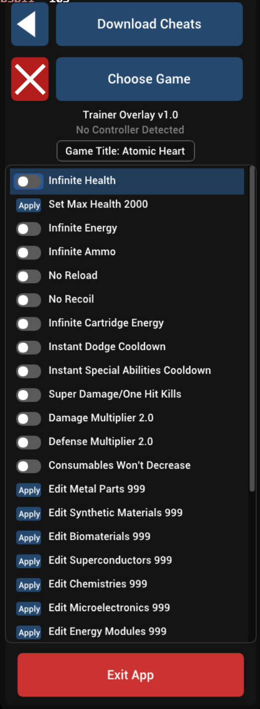
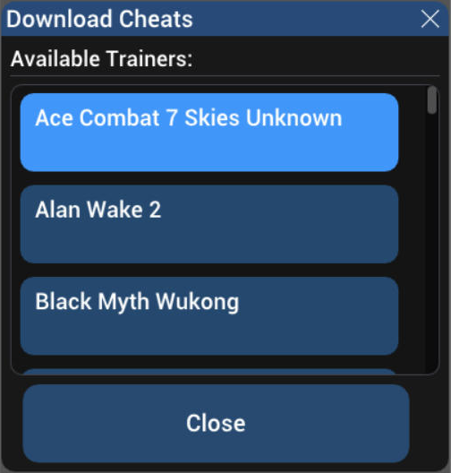
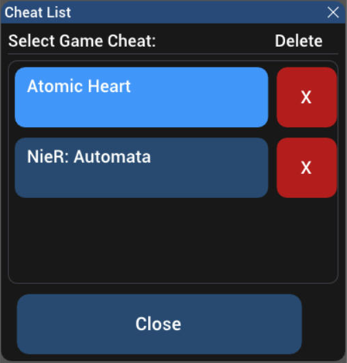

<p align="center">
  
</p>

<h1 align="center">Trainer Overlay</h1>

<p align="center">
  <b>Game trainers you can use from the couch.</b><br>
  A slide-in overlay for PC game trainers that you drive with a controller, so you never have to Alt+Tab out of a game.
</p>

<p align="center">
  <a href="../../releases/latest"></a>
  <a href="../../releases/latest"></a>
  
  <a href="LICENSE"></a>
  <a href="../../stargazers"></a>
</p>

<p align="center">
  <a href="https://github.com/ilukezippo/trainer-overlay/releases/download/v1.0/TrainerOverlay_v1.0_Installer.exe"></a>
</p>

<p align="center">
  <sub>Downloads the installer straight away. Prefer no install? Get the <a href="https://github.com/ilukezippo/trainer-overlay/releases/download/v1.0/TrainerOverlay_v1.0_Portable.zip">portable ZIP</a>.</sub>
</p>

<p align="center">
  <a href="../../releases/latest">All downloads</a> ·
  <a href="#how-to-use">How to use</a> ·
  <a href="#controls">Controls</a> ·
  <a href="CHANGELOG.md">What's new</a> ·
  <a href="#included-trainers">Trainers</a>
</p>

<table align="center">
  <tr>
    <td align="center" valign="top"><br><sub>A trainer loaded</sub></td>
    <td align="center" valign="top">
      <br><sub>Download Cheats</sub><br><br>
      <br><sub>Choose Game</sub>
    </td>
  </tr>
</table>

<p align="center"><sub>If Trainer Overlay saves you time, a ⭐ star on this page helps other people find it.</sub></p>

> ⚠️ Use responsibly. Trainer Overlay is meant for **offline, single-player** games. Don't use it in online or competitive games.

---

## Why

Trainers are made for a mouse and keyboard: you leave the game, find the trainer window, click a checkbox and go back. That's awkward on a handheld like the ROG Ally or Steam Deck, and on a TV with a controller in your hand.

Trainer Overlay puts the trainer inside a panel that slides in over the game. You open it with a button combo, move through the cheats with the D-Pad and switch them on with **A**. The game keeps focus the whole time.

## How to use

1. Start Trainer Overlay. It sits in the system tray.
2. Press **Shift + Insert**, or **L2 + R2 + L3 + R3** on an Xbox-style controller, to slide the panel in.
3. Choose **Download Cheats** to get a trainer for your game from this page, or **Choose Game** to load one you already have.
4. Move to a cheat and press **A** to switch it on or apply it.
5. Press the same combo again to hide the panel and keep playing.

## Controls

**Keyboard**

| Key | Action |
|---|---|
| `Shift + Insert` | Show or hide the overlay |
| `Esc` | Close a popup, or hide the overlay |

**Controller**

| Button | Action |
|---|---|
| `L2 + R2 + L3 + R3` | Show or hide the overlay (XInput: Xbox, ROG Ally) |
| `L2 + R2 + Start + Select` | Show or hide the overlay (DirectInput: PS4, PS5) |
| D-Pad / left stick | Move (hold to keep scrolling) |
| `A` | Select |
| `B` | Back |
| `L1 / R1` | Jump 5 items up or down |

## Features

- **Controller first.** Works with XInput (Xbox, ROG Ally) and DirectInput (PS4 and PS5) pads, with hold-to-repeat and jump scrolling.
- **Doesn't steal focus.** The panel is borderless and always on top, and it never takes focus away from the game.
- **Trainer library.** Each trainer is described by a small JSON file: game name, trainer exe, categories and cheats. Cheats can be toggles or one-shot actions.
- **Download from inside the app.** The app lists the trainers in this repo's `remote_trainers` folder and downloads the one you pick.
- **System tray.** Left-click the tray icon to show or hide the panel; right-click for Open and Exit.
- **Sounds.** Steam-style sounds for open, close, move, select and back.

## Install

**Installer:** download `TrainerOverlay_v1.0_Installer.exe`, run it (as Administrator is recommended), pick a folder, then start **Trainer Overlay** from the desktop shortcut.

**Portable:** download `TrainerOverlay_v1.0_Portable.zip`, extract it anywhere and run `TrainerOverlayExternal.exe`. Everything stays in that folder.

> Windows SmartScreen may warn the first time because the app isn't signed. Click **More info → Run anyway** if you trust where you downloaded it.

## Included trainers

The `remote_trainers` folder has ready-made packs for 35 games, including Cyberpunk 2077, Elden Ring Nightreign, God of War Ragnarök, Ghost of Tsushima, Hollow Knight Silksong, Marvel's Spider-Man 2, Resident Evil 4 and The Last of Us Part I and Part II. Open **Download Cheats** in the app to see the full list.

## What's in this repo

```
Release/            the app build (TrainerOverlayExternal.exe, sounds, font)
remote_trainers/    trainer packs the app can download, one ZIP per game
assets/, shots/     pictures for this page
```

## Known limits

- A trainer only works with the game version it was made for. If a game updates, its cheats may stop working until the pack is updated.
- Some antivirus tools flag trainers because they change game memory. That's expected for this kind of tool.
- Windows only.

## Privacy

Trainer Overlay doesn't collect anything. It only goes online when you open **Download Cheats**, to list and download trainer packs from this GitHub repo. See [PRIVACY.md](PRIVACY.md).

## License

[MIT](LICENSE) © ilukezippo
